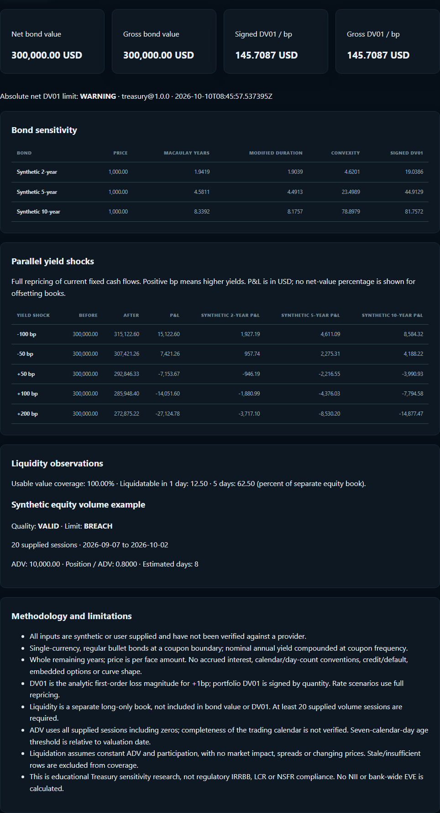

# Treasury and liquidity lab

Open `/treasury` after starting the existing API and web app. This is an additive research
workspace; the stock start, investor ledger and risk engine remain available. No database migration
or new dependency is required. Two bounded, stateless endpoints are added:

- `POST /api/v1/treasury/analyze`: bond sensitivity, signed aggregation, rate scenarios,
  separate equity liquidity estimates and research-limit states.
- `POST /api/v1/treasury/report`: self-contained HTML with positions, contributions, limits,
  quality states, methodology, generation time and the complete reproduction inputs.



The UI supports up to 30 bonds and one editable equity liquidity position. The API accepts up to
30 liquidity positions. All positions use the request currency; there is no implicit FX conversion.
Inputs are either visibly synthetic or user supplied and unverified. They are held in page memory;
reload discards edits. Analysis sends the inputs to the local API but does not save them.

## Bond convention

The model values regular fixed-coupon bullet bonds at a coupon boundary, with whole remaining
years. Face amount and signed quantity determine the position value. A negative quantity represents
a short position. Annual coupon and nominal annual yield are decimal fractions; compounding matches
coupon frequency (1, 2, 4 or 12). For `n = years × m`, period `k` has cash flow `C_k`:

```text
P = sum C_k / (1 + y/m)^k
D_Mac = sum (k/m) C_k / (1 + y/m)^k / P
D_Mod = D_Mac / (1 + y/m)
Convexity = sum k(k+1) C_k / [m² (1+y/m)^(k+2)] / P
DV01 = P × D_Mod × 0.0001
Signed portfolio DV01 = sum quantity_i × DV01_i
Gross portfolio DV01 = sum abs(quantity_i × DV01_i)
```

DV01 is a first-order positive loss magnitude for a long bond under +1bp, signed by quantity at
portfolio level. The -100, -50, +50, +100 and +200bp scenarios use full cash-flow repricing, not
the duration approximation. Position P&L reconciles to the portfolio change. No percentage of net
value is shown: a long/short book can have zero net value while carrying gross exposure.

No yield is inferred from a market price. No accrued interest, settlement calendar, day-count,
curve bootstrapping, credit/default, optional cash flows or non-parallel shocks are modeled.
Maturity is an input convention, not a sourced maturity date. Money uses Decimal arithmetic;
the core calculations use an explicit 40-digit context.

## Liquidity convention

Supply chronological `YYYY-MM-DD,volume` rows for 20–252 sessions. Duplicate, unordered, negative,
non-finite or future observations fail validation. Zero-volume sessions count in ADV; missing sessions
are not invented. The trading calendar and provider provenance are not independently verified.

```text
ADV = mean(supplied session volumes)
capacity = ADV × participation
days = ceil(quantity / capacity)
fraction liquidatable over h sessions = min(1, h × capacity / quantity)
```

Participation choices are 5%, 10% and 20%. Fewer than 20 sessions or zero ADV produces an
insufficient state. Price or latest volume more than seven calendar days older than the selected
valuation date produces a stale state. This threshold is a disclosed research convention, not a
trading-calendar guarantee. Historical as-of analysis is possible; freshness is relative to that
date rather than today's date.

The equity book is separate from bond value and DV01. Portfolio liquidation percentages are
reference-value weighted. All rows must have usable data; otherwise whole-book percentages are
withheld and usable-value coverage is disclosed. Raw stale-row estimates remain labelled stale.
Constant volume, fixed participation and fixed prices exclude spread costs and market impact.

## Research limits

The optional absolute **net** DV01 limit is WARNING at 80% of the threshold and BREACH above it;
the boundary itself is WARNING. Gross DV01 remains visible so offsets do not conceal exposure.
Liquidity is WARNING at the configured day limit and BREACH above it. Unusable data returns
INSUFFICIENT, never OK. Limits are calculated per request without alert delivery or durable history.

## Five-minute interview demonstration

1. Load **Maturity ladder**, calculate and trace the three bonds to signed portfolio DV01.
2. Load **Long duration**. Compare its +100bp loss with the ladder. Explain why duration is
   local sensitivity while full repricing captures curvature.
3. Load **Offsetting sensitivities**. Equal opposite exposures give zero net DV01 and positive
   gross DV01. Explain that this does not model financing, counterparty risk or a real hedge trade.
4. Compare 5%, 10% and 20% ADV participation. Then remove volume history and demonstrate the
   insufficient-data state rather than an invented liquidation period.
5. Export HTML and inspect the input evidence, conventions, quality and per-position stress P&L.

All three cases are synthetic educational examples, not historical crisis replays or actual
investment portfolios. No external market-data date range or observed performance is claimed.
For a bank internship discussion, be prepared to derive the zero-coupon duration identity and
explain why these sensitivities do not establish regulatory IRRBB compliance.

IRRBB educational copy distinguishes repricing, yield-curve, basis and optionality risks, and the
earnings (NII) and economic-value (EVE) perspectives. Definitions follow the
[Basel Committee application guidance](https://www.bis.org/basel_framework/chapter/SRP/98.htm).
The bond intuition is consistent with
[FINRA's duration explanation](https://syndication.finra.org/content/duration-what-interest-rate-hike-could-do-your-bond-portfolio).
This module calculates neither bank-wide NII nor EVE.

## Requested-feature gap assessment

This assessment was made against the existing local implementation before this addition. The
imported proposal is a backlog, not a replacement architecture or a claim that every item is done.

| Requested area | Existing baseline | This increment / remaining gap |
| --- | --- | --- |
| Real market data | PARTIAL: Yahoo snapshot refresh and dated stock closes | Preserved; provider-neutral OHLCV, NBP, Stooq, rate adapters and cache remain deferred |
| Practical portfolios | PARTIAL: local investor ledger, flows, CSV preview, JSON backups | Preserved; authenticated durable workspace remains deferred |
| Portfolio dashboard | EXISTING: investor overview, exposures, performance and risk | Preserved; unified period controls and benchmark analytics remain deferred |
| Risk dashboard | EXISTING: pure VaR/ES, volatility, drawdown, covariance and signed contributions | Reused unchanged; no duplicate VaR/accounting implementation |
| Stress | PARTIAL: combined user asset/FX scenarios | Added bond yield shocks; sourced historical crisis replay remains deferred |
| Liquidity | MISSING: observed-volume liquidation capacity | Added supplied-session ADV, capacity, coverage, quality and limits; automatic volume fetch deferred |
| Treasury | MISSING: regular bond duration, DV01 and convexity | Added pure model, editable UI, full rate repricing and IRRBB education; curve and optionality models deferred |
| Currency risk | PARTIAL: explicit FX, exposures and scenarios | Preserved; sourced multi-provider FX history and FX attribution deferred |
| Limits | PARTIAL: personal concentration threshold | Added net DV01 and liquidation limits; durable history and broader limit suite deferred |
| Report | PARTIAL: investor HTML and research JSON/CSV | Added Treasury HTML with full inputs; combined cross-workspace report deferred |
| Product UI | EXISTING: stock start, investor and research routes | Added `/treasury`, preserved default route and owner edits |
| Recruitment cases | PARTIAL: fictional investor example and research fixtures | Added three reproducible Treasury illustrations; three sourced multi-asset cases deferred |
| README | EXISTING: product workflow and engineering evidence | Small additive product introduction and lab link; no large rewrite |

Verification outcomes and environment limitations are recorded in `progress.md` and `../HANDOFF.md`.
